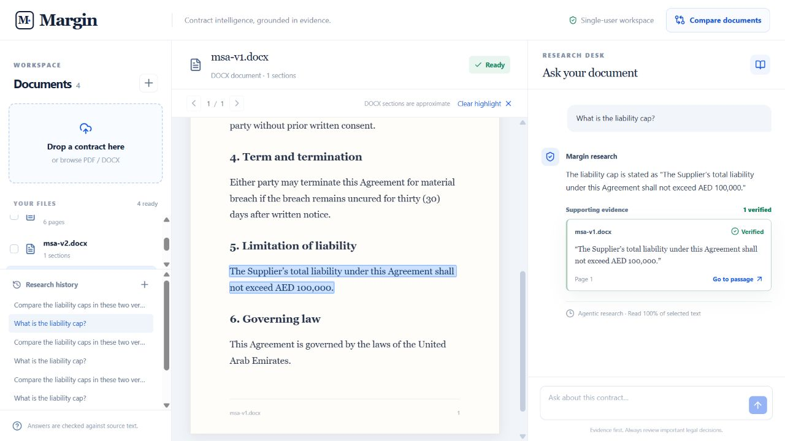

# Margin

**Contract intelligence, grounded in evidence.** Margin is a single-user web app for reading PDF and DOCX contracts, researching questions with source-linked quotes, and comparing two versions clause by clause. It never labels a quote Verified until the application finds it in the attributed document's extracted text.

> **Submission status:** [margin-contract-research.vercel.app](https://margin-contract-research.vercel.app) is live with Turso, private Blob storage, and an OpenAI-compatible model. The production smoke test passed with DOCX, PDF, a 150-page contract, scanned-PDF rejection, saved verified chat, multi-document comparison, and clause comparison. A 5.3 MB browser upload also processed to 150 pages. The table below remains explicit about unfinished stretch requirements.

## Screens

| Upload and empty state | Chat with verified quote |
|---|---|
|  |  |

| Citation highlighting | Clause comparison |
|---|---|
|  |  |

## What is finished

| Assignment area | Status | Evidence |
|---|---|---|
| PDF/DOCX upload, type rejection, saved library, delete | ✅ Live verified | Production smoke, browser upload and delete, local browser test |
| Text extraction and scanned/no-text PDF rejection | ✅ Live verified | 6-page PDF, DOCX pair, and no-text PDF in production smoke |
| 150-page ingestion and page-120 text access | ✅ Live verified | Production smoke; 5.3 MB direct browser upload |
| Quote verification, whitespace/Unicode mapping, wrong-document and amount-tampering rejection | ✅ Unit verified | `tests/quotes.test.ts` |
| Citation click to exact extracted passage | ✅ Live browser verified for DOCX | Saved quote opened and highlighted the exact passage; local browser test |
| Agentic five-tool loop, malformed-call handling and caps | ✅ Live loop and mock tests; cap edge cases need wider fault testing | Production chat showed multiple read-only tool rounds; unit tests |
| Streaming answer and Stop with saved partial | ✅ Live browser verified | Stopped a streaming draft and reopened it after a reload; `tests/chat-stop.test.ts` |
| Saved chat history | ✅ Live verified | Production smoke and browser reopen |
| Multi-document comparative answers | ✅ Live verified for two DOCX versions | Production smoke requires both amounts and a verified quote from each document |
| Clause-level comparison and significance filter | ✅ Live verified | Production smoke flags AED 100,000 → AED 1,000,000 as High; browser test |
| Cross-page and repeated quote highlighting | ⚠️ Matcher unit tested; full browser flow unverified | `tests/quotes.test.ts` |
| Original PDF page overlay, OCR, exhaustive map-reduce, exported report | ❌ Not built | See limitations |
| Public live deployment, GitHub link, 3–5 minute recorded demo | ✅ Live URL and existing 3:27 captioned demo | Production `/api/health` and smoke passed; [download the demo](docs/demo.webm) |

The complete requirement mapping is in [docs/REQUIREMENTS.md](docs/REQUIREMENTS.md). The status table intentionally distinguishes local, mock, and live verification.

[Production verification log](docs/LIVE_VERIFICATION.md) records the checks run against the public URL.

[Download the 3:27 captioned walkthrough](docs/demo.webm). It was recorded before the live model key was configured, so the chat segment shows the extractive fallback. GitHub stores the video but may require downloading it rather than playing it inline.

## How it works


The agent can search, read a numbered section, list clauses, read a page, and read a block range. The model returns quote text and document ID only. Margin locates all occurrences itself, computes source offsets and page spans, and removes unsupported quotes from the evidence list. Search coverage is the union of text actually returned to the model. A partial read cannot support a claim that a clause is absent. PDF pages are real; DOCX "sections" are approximate text windows.

Comparison aligns numbered clauses, then uses deterministic checks for money and timing changes. A liability cap changing from AED 100,000 to AED 1,000,000 is High significance even without a model call. The summary is a heuristic, so review the shown before/after wording.

## Run locally

Node.js 22+ and npm are required. The project uses libSQL locally and Turso remotely; no native SQLite build step is needed. The project was tested on Node 24, Windows.

```bash
npm ci
cp .env.example .env.local
# Set LLM_API_KEY in .env.local for model-backed research.
npm run gen:fixtures
python scripts/gen-pdf-fixtures.py
npm run dev
```

Open `http://localhost:3000`. For offline verification:

```bash
npm run lint
npm run typecheck
npm test
npm run smoke
npm run screenshots
npm run record:demo
```

The smoke command expects a running app and uses generated DOCX fixtures plus a 150-page PDF fixture. If the assignment PDF is present at `hiring assignment.pdf`, it also checks that file. `SMOKE_BASE_URL` overrides the default local URL.

| Variable | Purpose | Default |
|---|---|---|
| `DATA_DIR` | Local SQLite database and uploaded files | `./data` |
| `TURSO_DATABASE_URL`, `TURSO_AUTH_TOKEN` | Persistent production database | unset locally |
| `BLOB_READ_WRITE_TOKEN` | Private Vercel Blob upload storage | unset locally |
| `LLM_API_KEY` | OpenAI-compatible provider key | unset (extractive fallback) |
| `LLM_BASE_URL` | Provider endpoint | `https://api.openai.com/v1` |
| `LLM_MODEL` | Inexpensive provider model | `gpt-4o-mini` |
| `MAX_UPLOAD_MB`, `MAX_PAGES` | Upload and PDF limits | 40 MB, 400 pages |
| `AGENT_MAX_ROUNDS`, `AGENT_MAX_TOKENS_BUDGET`, `AGENT_TIMEOUT_MS` | Research limits | 8, 20,000, 90,000 ms |
| `APP_ORIGIN` | Accepted browser origin for mutations | `http://localhost:3000` |

## Deploy on Vercel

Create a Vercel project from this repository. Connect a **private** Vercel Blob store and a Turso Cloud database to the project for Production and Preview. The integration must provide `BLOB_READ_WRITE_TOKEN`, `TURSO_DATABASE_URL`, and `TURSO_AUTH_TOKEN`. Set `LLM_API_KEY` as an encrypted project variable; the default base URL and model already target OpenAI. Deploy with `vercel deploy --prod` and confirm `/api/health` returns `{ "ok": true }`. Run `SMOKE_BASE_URL=https://your-domain npm run smoke` with disposable fixtures against the deployed service. The application uses Blob for uploaded files and Turso for persistent document, search, chat, and comparison records. Browser uploads larger than 4 MB go directly to private Blob to avoid Vercel's request-body limit. A database lease prevents repeated polling from starting the same extraction job on multiple functions.

The production Vercel project currently has the private Blob store, Turso database, and a sensitive model key connected. The earlier Railway workspace rejected new services due to an account restriction; `Dockerfile` and `railway.json` remain available for a volume-backed alternative.

## Security and limits

The API validates file content and size, stores uploads under UUID filenames, checks browser origins, rate limits mutations, and renders document/model text as React text or sanitized Markdown. The five agent tools are read-only and scoped to selected documents. `npm audit --omit=dev` reported **0 production dependency vulnerabilities** on the tested lockfile. This is a single-user assignment app without accounts or tenant isolation; avoid uploading confidential contracts to its public URL.

Known limits: no OCR; no original PDF canvas overlay; partial scans are not identified page by page; DOCX tables and numbering can differ from Word's layout; FTS5 retrieval is not an exhaustive search; quote verification can reject true quotes when extraction loses characters; a repeated quote may be ambiguous; and comparison alignment/significance are heuristics. The live model was tested against the supplied fixtures and can still vary on unseen contracts. Invalid model output falls back to limited verified extracts. Stopped drafts are saved before quote verification and are explicitly labelled unverified.

See [engineering decisions](docs/DECISIONS.md), [architecture](docs/ARCHITECTURE.md), [API](docs/API.md), [half-page note](docs/NOTE.md), and [recording plan](docs/DEMO_SCRIPT.md).

The verification workflow is supplied as [docs/ci-template.yml](docs/ci-template.yml). The GitHub credential on this machine lacks the `workflow` scope needed to place it under `.github/workflows/`; move it there when using a credential with that scope.
