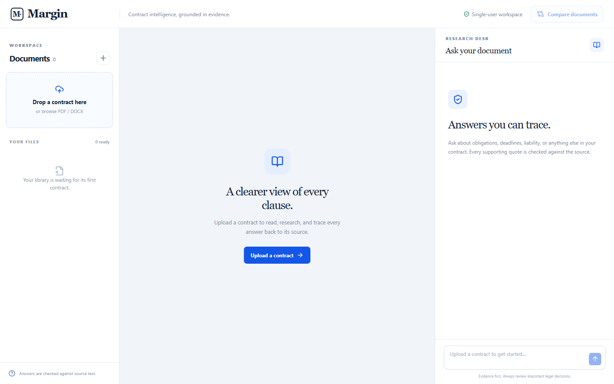
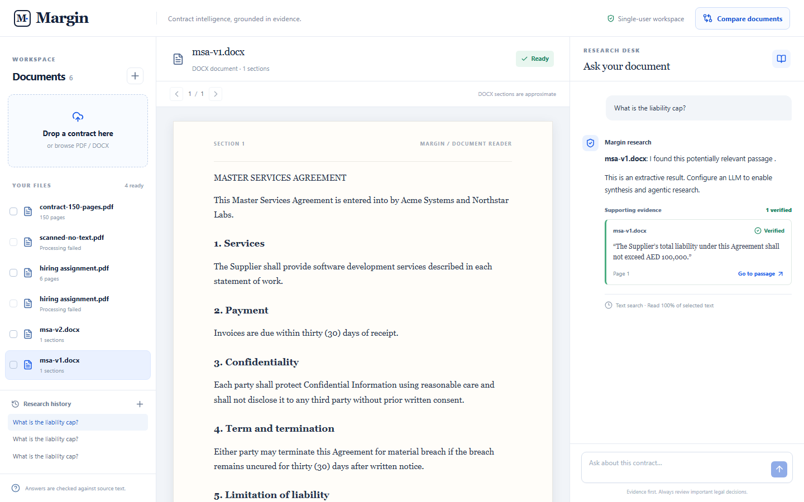
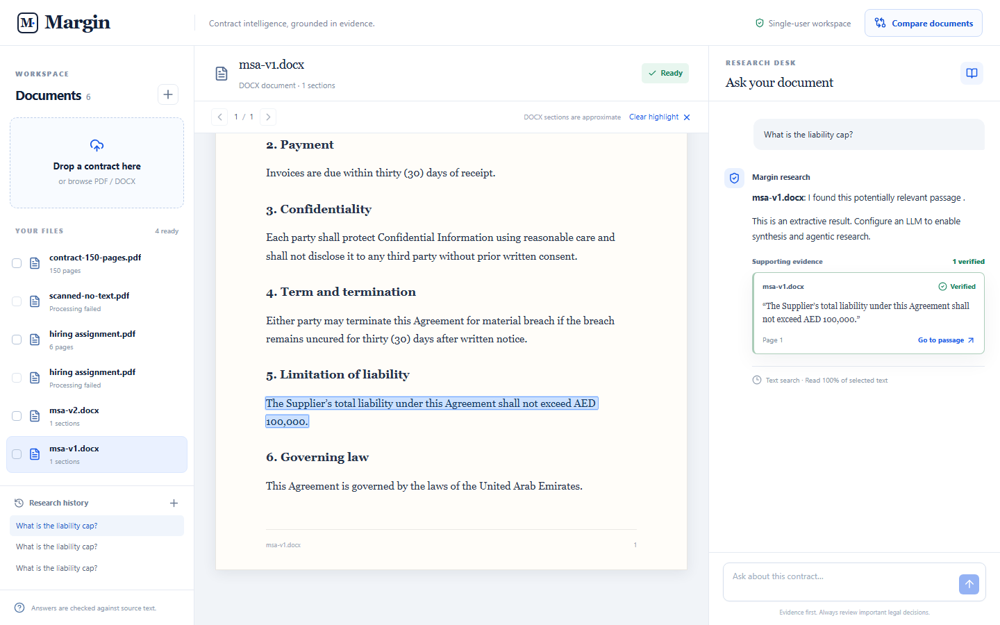
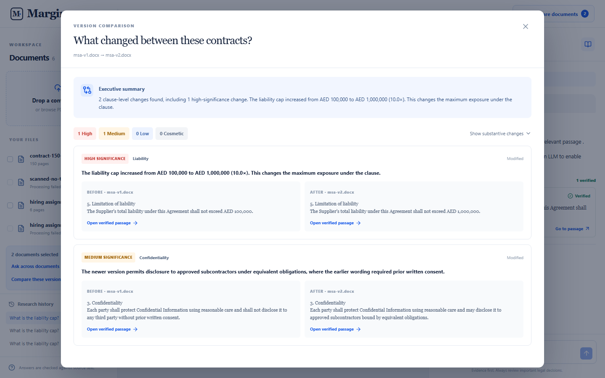
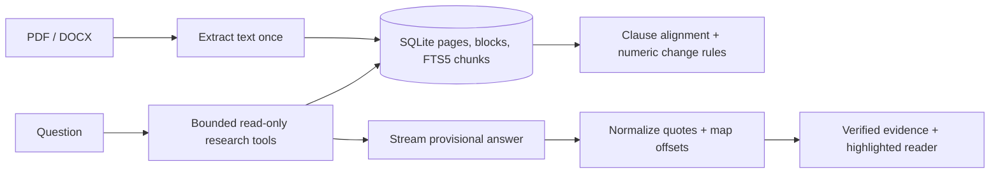

# Margin

**Contract intelligence, grounded in evidence.** Margin is a single-user web app for reading PDF and DOCX contracts, researching questions with source-linked quotes, and comparing two versions clause by clause. It never labels a quote Verified until the application finds it in the attributed document's extracted text.

> **Submission status:** the production build and smoke test pass locally. The [public GitHub repository](https://github.com/9059Rohith/margin-contract-research) contains the source. The signed-in Railway workspace refuses new services with “We limited this workspace after detecting unusual activity”; a public deployment is therefore blocked until that account restriction is lifted or another host with persistent storage is supplied. No model key is configured here. Without a key, chat gives a clearly labelled extractive search result rather than pretending model-based research ran.

## Screens

| Upload and empty state | Chat with verified quote |
|---|---|
|  |  |

| Citation highlighting | Clause comparison |
|---|---|
|  |  |

## What is finished

| Assignment area | Status | Evidence |
|---|---|---|
| PDF/DOCX upload, type rejection, saved library, delete | ✅ Locally verified | `npm run smoke`; browser walkthrough |
| Text extraction and scanned/no-text PDF rejection | ✅ Locally verified | 6-page PDF, DOCX pair, and no-text PDF in `npm run smoke` |
| 150-page ingestion and page-120 text access | ✅ Locally verified | `contract-150-pages.pdf` in `npm run smoke` |
| Quote verification, whitespace/Unicode mapping, wrong-document and amount-tampering rejection | ✅ Unit verified | `tests/quotes.test.ts` |
| Citation click to exact extracted passage | ✅ Browser verified for DOCX | `docs/screenshots/citation-highlight.png` |
| Agentic five-tool loop, malformed-call handling and caps | ⚠️ Mock verified; live provider unverified | `tests/agent-loop.test.ts`, `tests/agent-tools.test.ts` |
| Streaming answer and Stop with saved partial | ⚠️ Streaming tested with mocked provider; Stop persistence needs end-to-end test | `tests/agent-loop.test.ts` |
| Saved chat history | ✅ Locally verified | `npm run smoke`; browser reopen |
| Multi-document comparative answers | ⚠️ Selection and per-document verification built; live model synthesis unverified | `src/lib/agent/loop.ts` |
| Clause-level comparison and significance filter | ✅ Locally verified | `tests/compare.test.ts`, `npm run smoke`, browser walkthrough |
| Cross-page and repeated quote highlighting | ⚠️ Matcher unit tested; full browser flow unverified | `tests/quotes.test.ts` |
| Original PDF page overlay, OCR, exhaustive map-reduce, exported report | ❌ Not built | See limitations |
| Public live deployment, GitHub link, 3–5 minute recorded demo | ⚠️ Repository delivered; deployment and recording not delivered | Railway workspace restriction; recording plan in `docs/DEMO_SCRIPT.md` |

The complete requirement mapping is in [docs/REQUIREMENTS.md](docs/REQUIREMENTS.md). The status table intentionally distinguishes local, mock, and live verification.

## How it works



The agent can search, read a numbered section, list clauses, read a page, and read a block range. The model returns quote text and document ID only. Margin locates all occurrences itself, computes source offsets and page spans, and removes unsupported quotes from the evidence list. Search coverage is the union of text actually returned to the model. A partial read cannot support a claim that a clause is absent. PDF pages are real; DOCX "sections" are approximate text windows.

Comparison aligns numbered clauses, then uses deterministic checks for money and timing changes. A liability cap changing from AED 100,000 to AED 1,000,000 is High significance even without a model call. The summary is a heuristic, so review the shown before/after wording.

## Run locally

Node.js 22+ and npm are required. Native SQLite dependencies need a compatible prebuilt binary or a local C++ toolchain. The project was tested on Node 24, Windows, using `better-sqlite3` 13.

```bash
npm ci
cp .env.example .env.local
# Set LLM_API_KEY in .env.local for model-backed research.
npm run gen:fixtures
python scripts/gen-pdf-fixtures.py
npm run dev
```

Open `http://localhost:3000`. For offline verification:

```bash
npm run lint
npm run typecheck
npm test
npm run smoke
npm run screenshots
```

The smoke command expects a running app and uses generated DOCX fixtures plus a 150-page PDF fixture. If the assignment PDF is present at `hiring assignment.pdf`, it also checks that file. `SMOKE_BASE_URL` overrides the default local URL.

| Variable | Purpose | Default |
|---|---|---|
| `DATA_DIR` | SQLite and uploaded files; must be persistent in production | `./data` |
| `LLM_API_KEY` | OpenAI-compatible provider key | unset (extractive fallback) |
| `LLM_BASE_URL` | Provider endpoint | OpenRouter URL in `.env.example` |
| `LLM_MODEL` | Inexpensive provider model | `openai/gpt-4o-mini` |
| `MAX_UPLOAD_MB`, `MAX_PAGES` | Upload and PDF limits | 40 MB, 400 pages |
| `AGENT_MAX_ROUNDS`, `AGENT_MAX_TOKENS_BUDGET`, `AGENT_TIMEOUT_MS` | Research limits | 8, 20,000, 90,000 ms |
| `APP_ORIGIN` | Accepted browser origin for mutations | `http://localhost:3000` |

## Deploy on Railway

Use the included `Dockerfile` and `railway.json`. Mount one persistent volume at `/data`, set `DATA_DIR=/data`, `APP_ORIGIN` to the assigned HTTPS domain, and set `LLM_API_KEY`, `LLM_BASE_URL`, and `LLM_MODEL` as Railway variables. Generate a service domain and confirm `/api/health` returns `{ "ok": true }`. Run `SMOKE_BASE_URL=https://your-domain npm run smoke` against the deployed service using disposable fixtures. Keep a single service replica because the rate limiter and background worker are process-local. Render with a persistent disk is another viable target; Vercel's ephemeral filesystem is unsuitable for this storage design. On 10 October 2026, Railway rejected project creation and adding a service to the signed-in workspace with the restriction quoted above; no live URL was created.

## Security and limits

The API validates file content and size, stores uploads under UUID filenames, checks browser origins, rate limits mutations, and renders document/model text as React text or sanitized Markdown. The five agent tools are read-only and scoped to selected documents. `npm audit --omit=dev` reported **0 production dependency vulnerabilities** on the tested lockfile. Do not upload confidential contracts to an untrusted public deployment: this is a single-user assignment app without accounts or tenant isolation.

Known limits: no OCR; no original PDF canvas overlay; partial scans are not identified page by page; DOCX tables and numbering can differ from Word's layout; FTS5 retrieval is not an exhaustive search; quote verification can reject true quotes when extraction loses characters; a repeated quote may be ambiguous; the in-process worker is recoverable on the next document-list request but has no distributed lease; and comparison alignment/significance are heuristics. Live-model behavior depends on the configured provider and has only been tested against a scripted OpenAI-compatible mock here.

See [engineering decisions](docs/DECISIONS.md), [architecture](docs/ARCHITECTURE.md), [API](docs/API.md), [half-page note](docs/NOTE.md), and [recording plan](docs/DEMO_SCRIPT.md).
