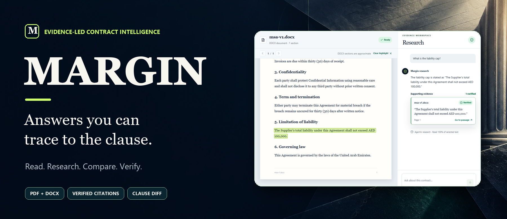
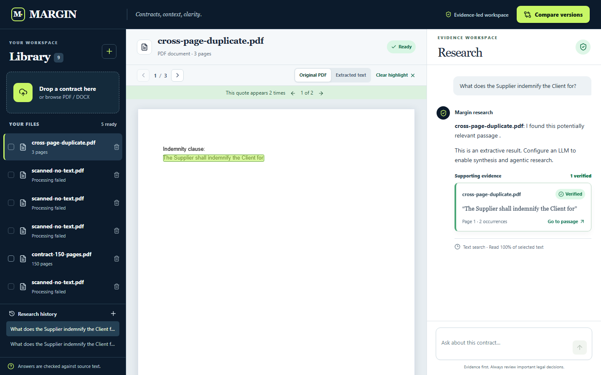
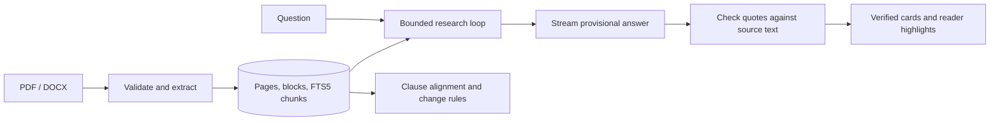

[](https://margin-contract-research.vercel.app/)

# Margin

**Contract research with an evidence trail.** Upload a PDF or DOCX, ask a question, inspect a source-checked quote in the document, and compare two contract versions clause by clause. Margin is a single-user hiring-assignment application built around one rule: a model's proposed quote is never labelled **Verified** until the application finds it in the correct source document.

| Open the product | Watch the 3:37 demo | Review the submission |
|:---:|:---:|:---:|
| **[Live application](https://margin-contract-research.vercel.app/)** | **[Narrated video with subtitles](https://drive.google.com/file/d/1Kn3XTk8AifESHZtr6lFynVqfSkDcKJJM/view)** | **[Requirement-by-requirement evidence](docs/REQUIREMENTS.md)** |

The video uses the deployed application and synthetic contracts. It has audio narration and burned-in subtitles; a [direct MP4](https://margin-contract-research.vercel.app/demo.mp4), [SRT](docs/demo.srt), and [WebVTT](https://margin-contract-research.vercel.app/demo.vtt) are also available. The [half-page engineering note](docs/NOTE.md) is the other written submission artifact.

## See it in action

| Verified answer and highlighted clause | Clause-level version comparison |
|:---:|:---:|
| [](docs/screenshots/live-citation.png) | [](docs/screenshots/comparison.png) |
| The quote is checked against `msa-v1.docx` before the badge appears. Clicking it opens the matching text. | A liability cap change from AED 100,000 to AED 1,000,000 is ranked High, with before/after wording and a significance filter. |

| Original PDF and repeated wording | First-run upload experience |
|:---:|:---:|
| [](docs/screenshots/pdf-citation.png) | [](docs/screenshots/upload-empty.png) |
| The PDF viewer opens the original page, highlights the quote, and lets the reader move between repeated occurrences. | The library accepts PDF and DOCX files and shows processing status. |

The screenshots show actual application states from synthetic fixtures. The [recorded walkthrough](https://drive.google.com/file/d/1Kn3XTk8AifESHZtr6lFynVqfSkDcKJJM/view) covers upload, a model-backed answer, citation navigation, original PDF highlighting, repeated occurrences, and comparison filtering in 3 minutes 37 seconds. Its narration is synthetic; no private contract or API key appears in the recording. The [recording script and scene outline](docs/DEMO_SCRIPT.md) and [browser tests](tests/e2e/contract-workflow.spec.ts) make the visual evidence reproducible.

## Assignment coverage

The supplied six-page assignment asks for document handling, grounded research, the optional advanced features, an agentic loop, and five submission artifacts. The [traceability matrix](docs/REQUIREMENTS.md) quotes every individual requirement and links it to implementation and verification. This table is the short route through it:

| Area | What is implemented | How it was checked |
|---|---|---|
| Document handling | PDF/DOCX acceptance, type rejection, extraction, processing status, saved library, open and delete; scanned PDFs with no readable text receive a clear failure | Production smoke, browser walkthrough, scan fixture |
| Research | Streaming answers, Stop with a saved partial draft, per-document chat history, a clear response when evidence is insufficient | Live browser, production smoke, unit tests |
| Source integrity | Server-side quote matching against the attributed document, whitespace/Unicode normalization, application-derived offsets, Verified badges only for matched text | Quote unit tests, production verified answers, browser citation navigation |
| Long contracts | One-time extraction and FTS5 indexing; bounded research on a 150-page fixture; text on page 120 is retrievable; partial-reading limits are disclosed | Production smoke and 5.3 MB direct browser upload |
| Advanced reading | Original PDF page rendering, click-to-highlight, cross-page and repeated-quote handling, multi-document questions with per-source citations | Browser suite and live checks |
| Version comparison | Clause/paragraph alignment, plain-language change summary, significance ranking and filter | Production and browser comparison checks |
| Agentic research | Multi-round model/tool loop, five read-only tools, live activity events, malformed-call handling, round/token/time caps, final quote verification | Scripted provider tests and live tool activity |
| Submission | Public GitHub repository, live Vercel app, detailed README, 3:37 narrated demo, half-page note | Links at the top of this page and [production log](docs/LIVE_VERIFICATION.md) |

All assignment rows in the traceability matrix are marked **Finished** with named evidence. This does not mean the application has been proven on every contract or provider. OCR, exhaustive map-reduce research, and an exported report are additional improvements from the separate build brief and remain unbuilt; see [Known limits](#known-limits-and-next-improvements).

## Product walkthrough

1. **Add a contract.** The library accepts PDF and DOCX, validates type and size, and shows the extraction state. A scanned PDF with no usable text fails visibly instead of becoming an empty “ready” document.
2. **Read it.** PDF pages render from the original private source file; extracted text is available as a fallback. DOCX content is presented as readable extracted sections. Open or delete any library item.
3. **Ask a question.** The agent searches indexed chunks and can read pages, numbered sections, the clause outline, or a bounded block range. The activity panel exposes those steps as they happen, while the answer streams. Stop preserves the visible partial text and marks it unverified.
4. **Check the evidence.** Every proposed quote is matched against the attributed document's canonical extracted text. The app calculates offsets and page spans itself, then shows a Verified source card. Clicking the card jumps to the passage and highlights it. Repeated wording gets occurrence navigation.
5. **Research across files.** Select several documents to ask one comparative question. Each source card identifies its document and is checked against that document, never the combined corpus.
6. **Compare versions.** Select two versions to see clause-level changes, a substantive summary, original before/after wording, and a significance filter. The demo highlights a tenfold liability cap increase.

## How evidence stays grounded



**Ingestion and storage.** Files are validated by content and size, stored under generated identifiers, and extracted once. Production keeps uploaded files in private Vercel Blob and document/search/chat records in Turso (libSQL); local development uses files and libSQL under `DATA_DIR`. PDF text is stored with real page boundaries. DOCX “sections” are approximate text windows, since Word layout is not a fixed page format. Search uses FTS5 chunks rather than sending an entire long contract to the model.

**The agent.** The configured OpenAI-compatible model can call `search`, `read_page`, `read_numbered_section`, `list_clauses`, and `read_block_range`. Tool arguments are validated before execution. Calls are read-only and scoped to selected documents. Round, token-budget, and time limits bound the research loop. Live status and tool events reach the browser over SSE. An installation without an LLM key falls back to limited extractive results rather than pretending to synthesize an answer.

**Verification boundary.** The model supplies quote text and a document identifier, never a trusted offset or page number. Margin normalizes both quote and source text, maps normalized positions back to canonical offsets, checks the right document, and derives the highlight spans. Unsupported quotations are removed from the evidence list; a wholly unsupported answer is downgraded. The UI reports coverage from text actually returned to the agent. A search over only part of a document cannot justify a whole-document absence claim. A stopped draft has not passed final quote verification and is labelled accordingly.

**Comparison.** Clause alignment groups corresponding numbered clauses, then deterministic checks identify changes in amounts and timing. The liability cap fixture moves from AED 100,000 to AED 1,000,000 and is marked High even without a model call. Summaries and alignment remain heuristic, so the UI keeps the before/after source wording visible.

The [architecture note](docs/ARCHITECTURE.md), [API reference](docs/API.md), and [engineering decisions](docs/DECISIONS.md) cover the implementation in more detail.

## Run locally

### Requirements

- Node.js **22+** and npm. This repository was exercised on Node 24 and Windows.
- Python 3 with `reportlab` only if you want to generate the PDF test fixtures or run the full smoke/browser suite.
- An OpenAI-compatible API key for model-backed research. The app can start without one, but will use its explicitly limited extractive fallback.

```powershell
git clone https://github.com/9059Rohith/margin-contract-research.git
cd margin-contract-research
npm ci
Copy-Item .env.example .env.local
```

Edit `.env.local` and set `LLM_API_KEY` to use live research. Keep that file private. For a local-only installation, leave Turso and Blob values empty: the app uses `./data` for its database and uploads. Then start it:

```powershell
npm run dev
```

Open [http://localhost:3000](http://localhost:3000). On macOS/Linux, use `cp .env.example .env.local` in place of `Copy-Item`; the other commands are the same. Never put a real key in `.env.example` or a commit.

### Generate fixtures and check the app

Run the fixture generation and static checks with the development server stopped:

```powershell
python -m pip install reportlab
npm run gen:fixtures
python scripts/gen-pdf-fixtures.py
npm run lint
npm run typecheck
npm test
npm run build
```

Start `npm run dev` again in one terminal, then run the live checks in another. The smoke test uploads disposable fixture documents to the target app, so use a development instance or a test deployment.

```powershell
npm run smoke
npx playwright install chromium
npm run test:e2e
```

`SMOKE_BASE_URL` defaults to `http://localhost:3000`. For a deployment check in PowerShell, set `$env:SMOKE_BASE_URL = 'https://your-domain.example'` before `npm run smoke`. The smoke script exercises DOCX, PDF, the 150-page fixture, a no-text scan, saved research, multi-document evidence, and version comparison. The browser suite checks citation navigation, repeated/cross-page wording, and a phone-width flow. The [10 October 2026 verification record](docs/LIVE_VERIFICATION.md) lists what passed locally and in production: lint, typecheck, build, **22 unit tests**, **3 browser tests**, production smoke, and the live health route. Fixture coverage is evidence for those cases, not a blanket correctness guarantee.

### Reproduce the visuals

```powershell
npm run screenshots
npm run record:demo
python -m pip install edge-tts pydub imageio-ffmpeg
python scripts/narrate-demo.py
python -m pip install Pillow
python scripts/build-readme-poster.py
```

The screenshot and recording scripts target `SMOKE_BASE_URL` (local by default) and may create disposable library records. `record:demo` writes a raw browser recording under `tmp/`; `narrate-demo.py` produces the MP4 and subtitle files. The README poster combines [generated background art](docs/assets/readme-background.webp) with a **real** [citation screenshot](docs/screenshots/live-citation.png), so the product UI in the banner is not a synthetic mockup.

## Configuration

Copy `.env.example` and set only the values your environment needs.

| Variable | Purpose | Local/default value |
|---|---|---|
| `DATA_DIR` | Local database and file storage | `./data` |
| `TURSO_DATABASE_URL`, `TURSO_AUTH_TOKEN` | Persistent hosted libSQL database | Empty for local storage |
| `BLOB_READ_WRITE_TOKEN` | Private Vercel Blob storage | Empty for local storage |
| `LLM_API_KEY` | Model provider secret | Empty; limited extractive fallback |
| `LLM_BASE_URL` | OpenAI-compatible endpoint | `https://api.openai.com/v1` |
| `LLM_MODEL` | Model identifier | `gpt-4o-mini` |
| `MAX_UPLOAD_MB`, `MAX_PAGES` | Upload and PDF page limits | 40 MB, 400 pages |
| `AGENT_MAX_ROUNDS` | Maximum model/tool rounds | 8 |
| `AGENT_MAX_TOKENS_BUDGET` | Approximate research token budget | 20,000 |
| `AGENT_TIMEOUT_MS` | Research timeout | 90,000 ms |
| `APP_ORIGIN` | Accepted browser origin for mutations | `http://localhost:3000` |

The API key stays server-side. The repository contains an example environment file, never the live secret. The actual production key is configured as a sensitive Vercel environment variable.

## Deploy

1. Import this repository into Vercel and set the project root to the repository root.
2. Attach a **private** Vercel Blob store and Turso database to the project. Ensure the Production environment has `BLOB_READ_WRITE_TOKEN`, `TURSO_DATABASE_URL`, and `TURSO_AUTH_TOKEN`.
3. Add `LLM_API_KEY` as a sensitive environment variable. Set `LLM_BASE_URL` and `LLM_MODEL` if you use a different compatible provider.
4. Deploy the main branch or run `vercel deploy --prod`. Check `/api/health` for `{ "ok": true }`, then run the smoke script with `SMOKE_BASE_URL` pointed at the deployed URL.

Files larger than Vercel's 4 MB request-body limit upload directly from the browser to private Blob and are validated server-side before registration. A database lease prevents repeated polls from starting duplicate extraction work across functions. The [production log](docs/LIVE_VERIFICATION.md) records a 5.3 MB, 150-page browser upload and original PDF rendering from private source chunks. `Dockerfile` and `railway.json` remain as a volume-backed alternative deployment path; the submitted live app is on Vercel.

## Security and data handling

Uploads have type, content, and size validation and use generated filenames. Browser mutations check origin and have rate limits. Document/model text is rendered as text or sanitized Markdown. Agent tools are read-only and scoped to the selected file set. The public demo is **single-user and has no accounts or tenant isolation**; use synthetic or non-confidential contracts there. The application is a research aid, and important legal conclusions should be checked against the original document.

## Known limits and next improvements

| Current limit | Practical consequence | Next improvement |
|---|---|---|
| No OCR | A fully scanned/no-text PDF is rejected with a clear message; partly scanned pages may be missed | Page-level scan detection and OCR with provenance |
| PDF extraction and geometry vary by file | Complex layouts can prevent a precise original-page overlay; the UI labels its verified extracted-text fallback | Broader layout corpus and stronger text-layer mapping |
| DOCX is linearized | Tables and numbering may differ from Microsoft Word's visual layout | Structure-aware DOCX reader |
| FTS5 and bounded reads are selective | A narrow search cannot prove a clause is absent from a long document | Exhaustive, budgeted map-reduce pass for absence questions |
| Quote matching is conservative | Real source text may fail verification if extraction drops or alters characters; repeated text can be ambiguous | Better normalization, occurrence disambiguation, evaluation set |
| Clause alignment and significance are heuristic | Some unusual redlines need manual review | Broader clause-change benchmarks and review controls |
| Single-user public workspace | No isolation for private team data | Authentication, tenant boundaries, retention controls |
| No exportable report | Findings live in the app and demo | Source-linked PDF/Markdown report export |

The separate master build brief suggested additional enhancements beyond the hiring PDF; the unbuilt items above are stated openly. The required assignment behavior and deliverables are mapped in [docs/REQUIREMENTS.md](docs/REQUIREMENTS.md).

## Submission links

- **Live app:** [margin-contract-research.vercel.app](https://margin-contract-research.vercel.app/)
- **Demo:** [3:37 narrated, subtitled Google Drive video](https://drive.google.com/file/d/1Kn3XTk8AifESHZtr6lFynVqfSkDcKJJM/view) · [MP4 fallback](https://margin-contract-research.vercel.app/demo.mp4)
- **Source and screenshots:** [this repository](https://github.com/9059Rohith/margin-contract-research) · [screenshots](docs/screenshots)
- **Engineering note:** [docs/NOTE.md](docs/NOTE.md)
- **Requirement evidence:** [docs/REQUIREMENTS.md](docs/REQUIREMENTS.md) · [live verification](docs/LIVE_VERIFICATION.md)

The verification workflow is provided as [docs/ci-template.yml](docs/ci-template.yml). The repository credential used during this assignment lacks the GitHub `workflow` scope required to install that file under `.github/workflows/`; a reviewer can run the commands above directly.
