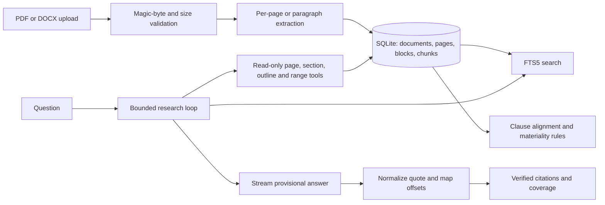

# Architecture

The source file, canonical extracted text, pages, blocks and search chunks are stored once. Model messages only receive bounded tool results. Every final citation is independently checked against the correct document's canonical text, then mapped back to blocks for highlighting. Conversation messages persist while streaming so stopped answers remain available.
