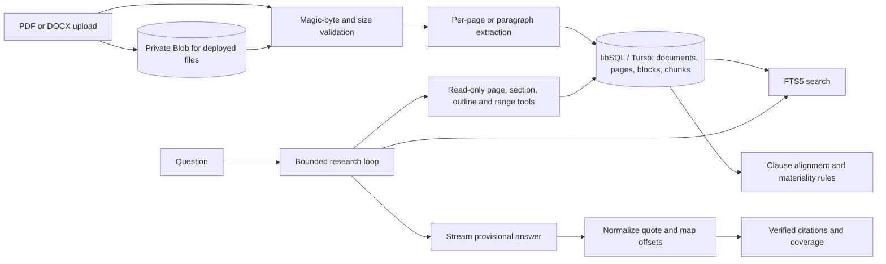

# Architecture

The source file is stored locally in development and in private Vercel Blob in production. Files over 4 MB upload directly from the browser to Blob, then the server validates their bytes before registration. Canonical extracted text, pages, blocks and search chunks live in local libSQL or hosted Turso. Model messages receive bounded tool results. Every final citation is independently checked against the correct document's canonical text, then mapped back to blocks for highlighting. The Stop endpoint saves the visible partial answer; late model output cannot overwrite it.
